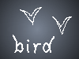

# Passerine

Turn the wheel to scroll. Hold Shift to scroll faster, and to show a pad combo on each link. Press that combo while Shift is held. A name with no page is ordinary text and has no combo.

A passerine is a perching bird. The order is Passeriformes, and more than half of living bird species sit inside it. Sparrows, warblers, finches, thrushes, swallows, crows, and the tiny New Zealand wrens are all passerines, even when they look nothing like one another. What they share is a foot built for gripping a twig, and a voice box that, in the songbirds, can make two sounds at once.

The name comes from the genus Passer, the Old World sparrows. [Sparrows](sparrows.md) are not the oldest members of the order, and they are not the largest. They are simply the birds Linnaeus had in mind when the group was named. A house sparrow on a gutter and a raven on a cliff are both passerines. So is a rifleman creeping up a trunk in New Zealand, and so is a swallow hawking insects over a field.

This page is the start of the sample. The other pages are short original notes on the same topics, written so there is enough text to scroll and enough links to open. Many names below have no page of their own. Those stay in the paragraph and get no pad combo. This page has more than six links, so each combo is two pads, such as 1-2. The 1 is red and the 2 is green, on the screen and on the pad. A shorter page uses one pad: 1, then 2, then 3. Only pads 1 through 6 are used. Their colors are red, green, blue, yellow, teal, and purple.

## What to open

- [Description](description.md) covers size, feathers, and the perching foot.
- [Anatomy](anatomy.md) covers the bill, the foot, and the syrinx.
- [Song](song.md) covers how that voice box is used.
- [Nests and eggs](nests.md) covers how the young are raised.
- [Origin](origin.md) covers where the order came from.
- [Taxonomy](taxonomy.md) splits the order into three groups.
- [Families](families.md) is a long list. Only three names on it can be opened.

## A foot on a twig

Watch a sparrow land. The toes close as the leg bends. The bird can sleep on a wire because the grip tightens when the body settles, not because the bird keeps thinking about its feet. That arrangement is called anisodactyl: three toes forward, one toe back. Woodpeckers and parrots grip too, but their toes are arranged differently, and they are not passerines.

The same foot shows up on a crow, a wren, and a bird of paradise. It does not show up on a duck, a hawk, or a heron. Those birds perch sometimes. They do not belong to this order. The [description](description.md) page stays with the foot, the feathers, and the range of sizes. The smallest passerines weigh a few grams. A raven weighs more than a kilogram. Both use the same toe plan.

## Voice

Most of the order can sing, and the group called the oscines, or songbirds, sings with the most control. The organ is the syrinx, sitting where the windpipe splits toward the lungs. Muscles around that fork stretch membranes, and the two sides can be driven separately. A thrush phrase that sounds like two flutes is often exactly that. [Song](song.md) follows the syrinx. [Anatomy](anatomy.md) names the parts around it.

Not every passerine song is learned. The New Zealand wrens, the sister group to the rest of the order, are not oscines. Suboscines, including many of the antbirds and tyrant flycatchers of the Americas, tend to inherit their songs instead of copying a neighbour. The split is the subject of [taxonomy](taxonomy.md).

## Nests

Passerines are famous for cup nests, but the order also hangs pouches, builds mud bottles, and lays eggs in other birds' nests. A songbird nest is often a cup of grass lined with hair, hidden in a shrub. A swallow may plaster mud under an eave. A weaver, which has no page here, ties a hanging ball of strips. Cuckoos are not passerines, but some passerines, including the indigobirds and whydahs, are brood parasites too. [Nests and eggs](nests.md) and [brood parasites](brood.md) are the pages for that.

Parents usually feed the young in the nest. The chicks hatch naked or nearly naked, eyes shut, and they grow fast. A small songbird can leave the nest in two weeks. The parents may keep feeding it in the bushes after that. Insects are the usual food for chicks, even in species that eat seeds as adults.

## Where they live

Passerines live on every continent except Antarctica. They are missing from the open ocean. Islands have their own forms: Hawaii once had a radiation of honeycreepers, New Zealand still has the wrens and the wattlebirds, and Madagascar has the vangas. Forests hold the most species. Fields, deserts, reed beds, and city streets hold fewer species, but often huge numbers of individuals. The house sparrow and the common starling followed people. Both are passerines. The starling has no page in this sample. The sparrow does: [sparrows](sparrows.md).

Migration is common and not required. A swallow may fly from Europe to southern Africa. A raven may stay in one valley all year. A tit may wander a few kilometres with the weather. The [origin](origin.md) page is about the older journey, out of the southern continents, not about the flight a bird makes each autumn.

## Three branches

Classifications change as DNA is compared, but a useful picture has three branches. The New Zealand wrens, Acanthisitti, are a handful of species and several that are already extinct. Everything else is either a suboscine or an oscine. Suboscines are richest in South and Central America. Oscines are richest everywhere else, and they also poured back into the Americas and became the warblers, the blackbirds, the cardinals, and the tanagers.

[Oscines](oscines.md), [suboscines](suboscines.md), and the [New Zealand wrens](wrens.md) each have a page. From the oscines you can open [crows](corvidae.md), [swallows](swallows.md), and [sparrows](sparrows.md). Those three also appear in the [family list](families.md). Hundreds of other family names appear there as text only.

## A few birds up close

A carrion crow walks more than it hops, watches other birds hide food, and can live for decades. A common raven is larger, more given to soaring, and just as much a passerine as the goldcrest that weighs less than a coin. Both are corvids. Jays, magpies, and nutcrackers are corvids too. [Crows, ravens, and jays](corvidae.md) collects them.

A barn swallow is built the other way: long wings, a short bill with a wide gape, and a life spent in the air. Martins are the same family. They still have the perching foot. They use it on a wire or a nest rim, not on a tree trunk. [Swallows and martins](swallows.md) is the page.

A house sparrow is the bird the order is named for. Males wear a grey crown and a black bib. The bill is a seed cracker for most of the year and a finer insect tool in the breeding season. Tree sparrows, rock sparrows, and the golden sparrow are relatives. American "sparrows" mostly belong to a different family and have no page here.

## How to move through this sample

The wheel scrolls one line at a time. Hold Shift and the wheel scrolls about half a screen, and every real link shows its pad combo. The page does not jump. Press the pads in that combo while Shift is still held. One pad is enough when the page has six links or fewer. The number sits on the link in white, inside that pad's color. B1 is Back and restores the scroll. B2 is Home and returns to this page. B3 closes the window. Shift and Erase together open the small menu, which is how this example quits.

Try a long path: this page, then [taxonomy](taxonomy.md), then oscines, then crows, then swallows. Back should climb down that stack and leave you where you scrolled. Home should jump here and clear it. Then open [families](families.md), scroll down, and hold Shift. Only Corvidae, Hirundinidae, and Passeridae show a combo. The other names do not.

## Names with no page

The sample mentions birds and people it does not open. [Charles Darwin](darwin.md) wrote about finch bills. [Feathers](feather.md) are the covering every one of these birds shares. [Weavers](ploceidae.md) build the hanging nests. [Starlings](sturnidae.md) mimic other sounds. [Bowerbirds](ptilonorhynchidae.md) decorate courts on the ground. None of those pages exist, so none of them show a pad combo. The words are here so the paragraphs read as a real article.

There is also no page for [Australia](australia.md), where many songbird lineages diversified, or for [South America](south-america.md), where the suboscines did the same. The [origin](origin.md) page tells that story without turning the place names into links.

Topics follow the Passerine article on Wikipedia. The wording here is a short original sample for this window, not the article itself.
